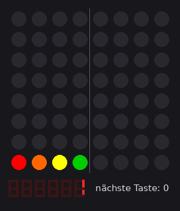

# Superhirn2090

Superhirn (im Original *Mastermind*) für den Busch Microtronic 2090 mit dem [ESP2090 Studio](https://github.com/rab-berlin/ESP2090) (8x8-LED-Matrix mit Farben): Der 2090 denkt sich einen Code aus vier Farben aus, man rät ihn in höchstens acht Versuchen. Nach jedem Versuch bewertet er ihn mit Stiften: magenta für jede Farbe am richtigen Platz, weiß für jede Farbe, die vorkommt, aber an einer anderen Stelle steht.

- 212 Programmschritte, 44 frei
- Datei: [superhirn.mic](superhirn.mic), das kommentierte Listing

## Spiel

Jede Zeile der Matrix ist ein Versuch. Versuch 1 steht in der untersten Zeile, jeder weitere eine Zeile darüber.

| Spalten | Inhalt |
|---|---|
| **links** (0-3) | die vier Stecker des Versuchs |
| **rechts** (4-7) | die Bewertung, von rechts nach links |

- **Farben der Stecker:** rot, orange, gelb, grün, türkis, blau. Jede Farbe darf mehrfach vorkommen.
- **Bewertung:** Für jede Farbe am richtigen Platz leuchtet ganz rechts ein **magenta** Stift (im Original schwarz). Links daneben leuchtet für jede Farbe, die vorkommt, aber an einer anderen Stelle steht, ein **weißer** Stift. Welcher Stift zu welchem Stecker gehört, verrät die Bewertung nicht.
- **Neuer Versuch:** Er beginnt als Kopie des letzten, man ändert nur die Stecker, die anders sein sollen. Der erste Versuch steht auf rot, orange, gelb, grün.
- **Gelöst:** vier magenta Stifte. Die Anzeige zeigt die Zahl der Versuche.
- **Aufgeben:** Mit `C` deckt das Programm den Code in der obersten Zeile auf, die Anzeige zeigt `0`.
- **Nicht gelöst:** Nach dem achten Fehlversuch rutscht das Brett eine Zeile nach unten, Versuch 1 verschwindet, und in der obersten Zeile steht der Code. Die Anzeige zeigt `0`.
- **Zufall:** Den ersten Code bestimmt die Zeit von RESET bis RUN, jeden weiteren die Wartezeit am Ende des vorigen Spiels. Alle 1296 Codes sind möglich.

## Start

1. Matrix einschalten („LED on“ in der Weboberfläche).
2. RESET, `HALT` `NEXT` `00` `RUN`.

In der untersten Zeile steht der erste Versuch, die Anzeige zeigt `1`. Nach dem Spielende startet eine beliebige Taste das nächste Spiel, ein RESET ist nicht nötig.

Das Programm färbt jedes Pixel selbst und benutzt nur die Farben, mit denen der ESP2090 startet.

## Bedienung

| Taste | Wirkung |
|---|---|
| `0` `1` `2` `3` | nächste Farbe für Stecker 1, 2, 3, 4 |
| `4` `5` `6` `7` | vorige Farbe für Stecker 1, 2, 3, 4 |
| `F` | Versuch bewerten |
| `C` | aufgeben, Code zeigen |
| `8` `9` `A` `B` `D` `E` | nichts |

- Die Farben laufen im Kreis: rot, orange, gelb, grün, türkis, blau, wieder rot.
- Die Anzeige zeigt beim Warten auf eine Taste die Nummer des Versuchs.
- Nach einer Farbtaste dauert es etwa 0,4 Sekunden, bis die nächste Taste angenommen wird, nach `F` etwa 2 Sekunden. In dieser Zeit nimmt das Programm keine Taste an.

## Einstellen

Farbnummern der Matrix: 1 rot, 2 orange, 3 gelb, 4 grün, 5 türkis, 6 blau, 7 violett, 8 magenta, 9 weiß.

- **Farbe für „richtiger Platz“:** Adresse 78, Befehl `18A` (`MOVI 8,rA`, magenta). Violett wäre `17A`.
- **Farbe für „falscher Platz“:** Adresse 7B, Befehl `19A` (`MOVI 9,rA`, weiß).
- **Erster Versuch:** Adressen 1B bis 1E, Befehle `110` `121` `132` `143` (`MOVI Farbe,r0` bis `r3`). Die mittlere Ziffer ist die Farbe 1-6.
- **Zahl der Versuche:** Adresse 80, Befehl `987` (`CMPI 8,r7`). Weniger Versuche gehen auch, zum Beispiel sechs mit `967`; mehr als acht passen nicht auf die Matrix.

## Wie es gemacht ist

- **Wo alles steht.** Der Versuch steht in R0 bis R3, ein Stecker je Register, als Farbnummer 1-6. Der Code steht während des ganzen Spiels in den Speicherregistern M8 bis MB.
- **Jede Taste verzweigt einzeln.** Ohne indirekte Adressierung kann das Programm nicht „Stecker k“ ändern. Es fragt die Taste nacheinander ab und hat für jeden Stecker ein eigenes kleines Stück Programm, das die Farbe in ein Hilfsregister holt, weiterschaltet und zurückschreibt.
- **Schwarze Stifte ohne Sprünge.** Für jeden Platz zieht das Programm die Farbe im Code von der im Versuch ab und dann noch 1. Ein Übertrag entsteht dabei nur, wenn beide Farben gleich waren, und `ADC` zählt genau diesen Übertrag. Vier Plätze, je vier Befehle.
- **Weiße Stifte über die Gesamtzahl.** Zuerst zählt das Programm, wie viele Stecker überhaupt eine passende Farbe im Code finden: Jeder Stecker sucht im Code eine gleiche Farbe, die noch frei ist, und markiert sie als vergeben (mit F, das ist keine Farbe). Weiß ist dann diese Zahl minus Schwarz. Das ergibt genau die Regel des Spiels, auch bei doppelten Farben.
- **Den Code nicht verlieren.** Das Markieren zerstört den Code. Deshalb holt `EXRM` ihn vor jeder Bewertung aus M8-MB in die Arbeitsregister, und `MAS` legt sofort wieder eine Kopie zurück. Der Versuch in R0-R3 bleibt dabei unverändert, er wird zur Kopie für den nächsten Versuch.
- **1296 Codes aus 12 Bit.** `RND` liefert drei Hex-Ziffern, die von der Wartezeit abhängen. Stecker 1-3 sind diese Ziffern geteilt durch 6, der Rest. Stecker 4 kommt aus den Quotienten dieser drei Divisionen. So sind alle 6 × 6 × 6 × 6 = 1296 Codes möglich. Einfachere Mischungen der drei Ziffern erreichen nur 216 oder 646 Codes.
- **Zwei Befehle je Pixel.** Die Matrix kennt Zeichenbefehle: erst die Farbe wählen, dann ein Pixel in dieser Farbe einschalten. Zwischen zwei Befehlen meldet sich der ESP2090 mit einem Signal (REQ) und wartet 30 ms auf den nächsten. Verpasst das Programm dieses Fenster, kostet das etwa 90 ms. Das Programm ist deshalb so geordnet, dass es nach jedem Befehl spätestens 56 ms später wieder auf das REQ wartet: Für die vier Stifte der Bewertung braucht es etwa 0,6 Sekunden statt fast 0,9.
- **Kopie durch Neuzeichnen.** Der neue Versuch übernimmt die Farben des letzten. Weil die Versuche fest übereinander stehen, zeichnet das Programm die vier Stecker in der nächsten Zeile neu, acht Befehle. Das ist der größte Teil der zwei Sekunden nach `F`.
- **Aufdecken.** Für den Code ist nach acht Versuchen keine Zeile mehr frei. Ein einziger Befehl schiebt das ganze Bild eine Zeile nach unten, dann zeichnet das Programm den Code in die frei gewordene oberste Zeile. Beim Aufgeben ist die oberste Zeile noch frei (oder es ist die des offenen Versuchs), dort steht der Code ohne Schieben.

## Geschichte

### Bulls and Cows und MOO

Das Spiel ist älter als sein Brett. Bei *Bulls and Cows* rät man mit Bleistift und Papier eine vierstellige Zahl; der Gegner sagt nur, wie viele Ziffern an der richtigen Stelle stehen (Bullen) und wie viele an der falschen (Kühe). Woher es stammt, weiß niemand genau, vielleicht ist es hundert Jahre alt.

Auf Computern lief es früh: In den 1960er Jahren schrieb Frank King eine Fassung namens *MOO* für den Rechner Titan der Universität Cambridge. Weitere Fassungen gab es für das Zeitteilungssystem TSS/8, für Multics am MIT und von Ken Thompson für Unix.

### Mastermind und Superhirn

Mit farbigen Steckern erfand Mordecai Meirowitz das Spiel 1970. Er war israelischer Postbeamter und Fachmann für Fernmeldetechnik. 1971 zeigte er es auf der Nürnberger Spielwarenmesse, wo die englische Firma Invicta Plastics die Rechte kaufte. Invicta überarbeitete das Spiel und brachte es 1971/72 als *Master Mind* heraus. Es wurde mit über 50 Millionen verkauften Exemplaren in 80 Ländern das erfolgreichste neue Spiel der 1970er Jahre. In Deutschland brachte es Parker als **Superhirn** heraus - was uns damals wie ein völlig legitimer Name für ein Spiel erschien.

Ende der 1970er Jahre kamen elektronische Fassungen, genau in der Art von Gerät, um die es hier geht: Invicta baute ein *Electronic Master Mind*, und Parker verkaufte 1978 das *SuperHirn electronic*, mit einem Expertenspiel aus fünf Steckplätzen und acht Farben, betrieben mit einer 9-Volt-Batterie. Statt farbiger Stecker zeigten solche Geräte Ziffern. Und wie könnte es anders sein - innendrin werkelte natürlich wieder ein TMS1000.

### Knuth und die fünf Versuche

Donald Knuth zeigte 1976/77 in seinem Aufsatz *The Computer as Master Mind*, dass man jeden der 1296 Codes in höchstens fünf Versuchen findet. Seine Strategie beginnt mit 1122, also zwei Farben je zweimal, und wählt dann immer den Versuch, der im ungünstigsten Fall am meisten Möglichkeiten ausschließt. Im Mittel braucht sie 4,478 Versuche. Kenji Koyama und Tony W. Lai fanden 1993 durch vollständige Suche die im Mittel beste Strategie: 5625/1296, etwa 4,340 Versuche.

Auf dem 2090 hat man acht Versuche und kein Papier, aber die Matrix hält alle Versuche fest. Ein einfacher Testspieler, der immer den ersten Code nimmt, der zu allen bisherigen Bewertungen passt, braucht meist vier bis sechs Versuche.

Wer den Code nach acht Versuchen immer noch nicht geknackt hat, macht was falsch - oder hat halt kein Superhirn.

## Quellen

- [Mastermind (board game)](https://en.wikipedia.org/wiki/Mastermind_(board_game)), Wikipedia
- [Mordecai Meirowitz](https://en.wikipedia.org/wiki/Mordecai_Meirowitz), Wikipedia
- [Invicta Electronic Master Mind](https://si.edu/object/invicta-electronic-master-mind-electronic-game:nmah_1305800), Smithsonian
- [Parker SuperHirn electronic](https://iser.wisski.data.fau.de/sites/default/files/wisski_original/fb058433f580234ac2f4ae7a602d63b3.pdf), Informatik-Sammlung Erlangen
- [The Computer as Master Mind](https://archive.org/download/pdfy-4zbExU0jr9Y81AAs/knuth-mastermind_text.pdf), Donald E. Knuth, J. Recreational Mathematics 9 (1976-77)
- [An Optimal Mastermind Strategy](https://prodigious.blog/wp-content/uploads/2025/08/optimal-mastermind-strategy.pdf), Kenji Koyama und Tony W. Lai
- [The Mysterious Origins of Mastermind](https://www.vice.com/en/article/permalink-mastermind-board-game-50th-anniversary-origins-fallout-cybersecurity), Vice
